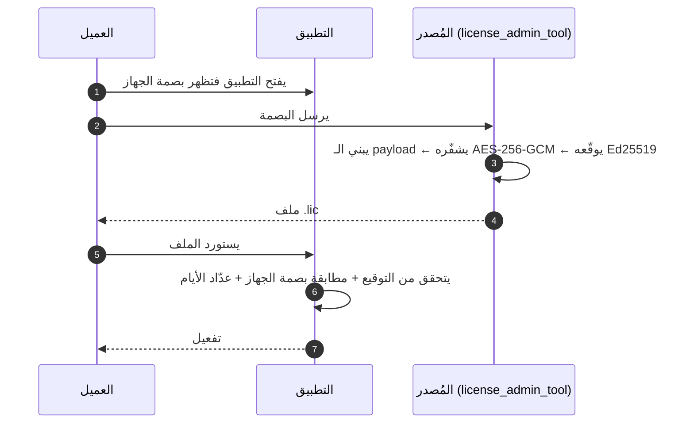
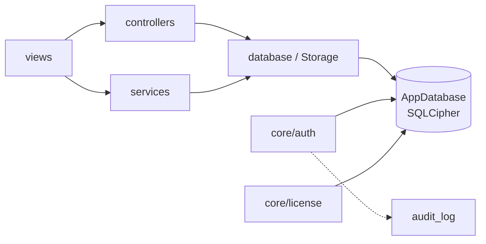

<div align="center">

# PureSip Payrolls

**نظام متكامل لإدارة المرتبات والموظفين — يعمل بدون إنترنت، مبني بـ Flutter**

[](https://github.com/ahmedtharwat19/payrolls/actions/workflows/ci.yml)


**[English](README.md)** · **العربية**

</div>

<div dir="rtl">

> [!NOTE]
> المنصة الأساسية المستهدفة هي **Windows**، مع دعم إضافي لـ **Android**.
> نسخة **الويب متوقفة افتراضيًا** لأن قاعدة البيانات فيها غير مشفّرة والترخيص أضعف.
> للتجربة فقط: `flutter run -d chrome --dart-define=ALLOW_WEB=true`

## المحتويات

- [نظرة عامة](#نظرة-عامة)
- [الجديد في هذا الإصدار](#الجديد-في-هذا-الإصدار)
- [المزايا الرئيسية](#المزايا-الرئيسية)
- [حساب الضريبة والتأمينات](#حساب-الضريبة-والتأمينات)
- [الأمان والمصادقة](#الأمان-والمصادقة)
- [الترخيص الأوفلاين](#الترخيص-الأوفلاين)
- [قاعدة البيانات والنسخ الاحتياطي](#قاعدة-البيانات-والنسخ-الاحتياطي)
- [هيكل المشروع](#هيكل-المشروع)
- [التقنيات المستخدمة](#التقنيات-المستخدمة)
- [البدء السريع](#البدء-السريع)
- [الاستيراد الجماعي من Excel](#الاستيراد-الجماعي-من-excel)
- [الاختبارات والتكامل المستمر](#الاختبارات-والتكامل-المستمر)
- [الإصدار والتوقيع](#الإصدار-والتوقيع)
- [الوثائق ذات الصلة](#الوثائق-ذات-الصلة)
- [خارطة الطريق](#خارطة-الطريق)
- [حقوق الملكية](#حقوق-الملكية)

---

## نظرة عامة

تطبيق موجّه للشركات الصغيرة والمتوسطة التي تريد إدارة مرتبات موظفيها **باستقلال تام عن الإنترنت** (Offline-first):

| المحور | ما يقدّمه التطبيق |
|---|---|
| **البيانات** | قاعدة بيانات محلية على جهاز العميل، مشفّرة بـ SQLCipher على سطح المكتب |
| **الترخيص** | تفعيل بملف `.lic` موقّع بـ Ed25519 ومربوط ببصمة الجهاز، بدون اتصال |
| **الحسابات** | ضريبة وتأمينات بشرائح قابلة للتعديل، مع دعم موظفي «الصافي» و«الإجمالي» |
| **المخرجات** | تقارير PDF بالعربية، وتصدير/استيراد Excel |
| **الصلاحيات** | مستخدمون وأدوار وسجل عمليات (Audit Log) |

---

## الجديد في هذا الإصدار

- **قاعدة بيانات محمولة (Portable):** تُحفظ بجوار ملف التشغيل (`.exe`) بدل مجلدات النظام المخفية.
- **اسم قاعدة ديناميكي:** يُقرأ اسم الشركة من `config.json` ويُسمّى به ملف القاعدة (مثل `omicron.db`)، مع **إعادة تشغيل تلقائية** عند تغيير الاسم لضمان استقرار الاتصال.
- **حقل «مؤمَّن عليه»:** تحديد خضوع الموظف للتأمينات الاجتماعية من عدمه؛ وإن لم يكن مؤمَّنًا تُصفَّر التأمينات تلقائيًا في كل الحسابات.
- **الدفع الجزئي والجماعي:** صرف دفعات مقدّمة (سلف) بنسبة 50% أو 30% أو نسبة مخصصة، لموظف واحد أو **لقسم كامل** دفعة واحدة.
- **تقارير PDF احترافية:** دعم كامل للعربية (Arabic Shaping)، وكشف مخصص للبنوك (IBAN & SWIFT)، وبيانات الشركة بلغتين في رأس التقرير.

---

## المزايا الرئيسية

### الموظفون
- بيانات كاملة: شخصية ووظيفية وبنكية.
- استيراد جماعي من Excel وتصدير نفس البيانات، وقالب فارغ جاهز.

### المرتبات
- جدول شهري لكل الموظفين: الأساسي، الإضافي، البدلات، الخصومات، الضريبة، التأمينات، الصافي (`payroll_page.dart`).
- **دبل كليك** على أي خلية في صف الموظف يفتح شاشة تفصيلية لتعديل الإضافي والبدلات والخصومات بسرعة (`employee_salary_detail_page.dart`).
- زر **«توليد»** في شريط العنوان لتوليد سجلات رواتب شهر معيّن لكل الموظفين دفعة واحدة.
- شريط تمرير أفقي واضح تحت الجدول، وتصدير PDF.
- **الرواتب السابقة** (`historical_payroll_page.dart`) وتسوية الدفعات الجزئية (`payment_adjustment_page.dart`, `record_payment_dialog.dart`).

### الحضور والتقارير
- الحضور والانصراف والإضافي والتأخير (`attendance_controller.dart`).
- تقارير إجمالي الصرف **كاش مقابل بنك** شهريًا (`reports_page.dart`).

### الإعدادات
- شرائح الضريبة، نسب التأمينات، بيانات البنك، قواعد العمل (`rules_page.dart`)، وبيانات الشركة (الاسم والعنوان للطباعة).

### الصلاحيات والمستخدمون
- أدوار وصلاحيات تُطبَّق فعليًا في الشاشات، وشاشة إدارة المستخدمين وعرض سجل العمليات.

### أدوات البيانات
- تصدير/استرجاع نسخة احتياطية كاملة، استيراد Excel، وتصحيح تكرار الأساسي/البدلات. الشاشة كلها تتطلب صلاحية `manageData`.

---

## حساب الضريبة والتأمينات

لكل موظف `salaryType` من نوعين، والمنطق في `payroll_calculation_service.dart` مع `tax_service.dart` و`insurance_service.dart`:

| النوع | المعنى | الأثر |
|---|---|---|
| **`gross` — إجمالي** | الراتب المُدخل هو الوعاء الضريبي | تُخصم الضريبة والتأمين منه مباشرة، فيقلّ صافي الموظف عن الرقم المتفق عليه |
| **`net` — صافي** | الراتب المتفق عليه هو ما **يصل للموظف** بعد الخصومات | الشركة تتحمّل العبء؛ يرفع النظام الوعاء تلقائيًا (**gross-up**) ببحث ثنائي حتى يصل الصافي للرقم المتفق عليه بالضبط |

المنطق موحّد في **مصدر واحد** (`PayrollCalculationService`) ومطبّق بنفس الطريقة في ثلاثة أماكن: جدول شاشة المرتبات، تصدير PDF، وتوليد السجلات الشهرية، لتتطابق الأرقام في كل مكان.

**قواعد الحساب**

1. الأجر التأميني = الأساسي + المتغيّر، بعد تطبيق الحدّين الأدنى والأقصى.
2. وعاء الضريبة السنوي = `(الدخل الشهري − حصة الموظف في التأمينات) × 12 − الإعفاء الشخصي`، ثم تُطبَّق الشرائح على الجزء الواقع داخل كل شريحة.
3. خصم التأمينات من وعاء الضريبة اختياري من إعدادات الضرائب.
4. كل المبالغ الناتجة تُقرَّب لأقرب قرش.

**القيم الافتراضية** (قابلة للتعديل من صفحة القواعد):

| البند | القيمة |
|---|---|
| الإعفاء الشخصي السنوي | 20,000 جنيه |
| تأمينات الموظف / الشركة | 11% / 18.75% |
| الحد الأدنى / الأقصى للأجر التأميني | 2,000 / 12,600 |
| الشرائح (سنويًا) | 0–40k: 0% · 40–55k: 10% · 55–70k: 15% · 70–200k: 20% · 200–400k: 22.5% · 400k–1.2M: 25% · فوق 1.2M: 27.5% |

> [!WARNING]
> هذه القيم افتراضية وتتغيّر كل سنة. **راجعها مع محاسبك القانوني** قبل الاعتماد عليها في صرف حقيقي.

---

## الأمان والمصادقة

| الطبقة | الآلية |
|---|---|
| **كلمات المرور** | PBKDF2-HMAC-SHA256 بـ 120 ألف تكرار وsalt عشوائي لكل مستخدم، وترقية تلقائية لأي تجزئة قديمة عند أول دخول ناجح |
| **سياسة كلمة المرور** | 8 أحرف على الأقل مع حروف وأرقام |
| **قفل الحساب** | بعد 5 محاولات فاشلة بمدة تتضاعف، وتُسجَّل كل محاولة في `audit_log` |
| **الحساب الأول** | يُنشأ حساب `admin` عند أول تشغيل مع **تغيير كلمة المرور إجباريًا** (وكذلك بعد أي إعادة تعيين من المدير) |
| **حماية الإدارة** | لا يمكن تعطيل أو حذف آخر مدير نشط، ولا تعطيل المستخدم لحسابه بنفسه |
| **تشفير القاعدة** | SQLCipher على سطح المكتب، ومفتاح التشفير محفوظ في `flutter_secure_storage` (DPAPI / Keychain / Keystore) |
| **العمليات الحساسة** | النسخ الاحتياطي والاستعادة ومسح البيانات تتطلب `manageData` وتُسجَّل في سجل العمليات |

### الأدوار الافتراضية

| الصلاحية | admin | hr | accountant | viewer |
|---|:-:|:-:|:-:|:-:|
| عرض الموظفين `viewEmployees` | ✅ | ✅ | ✅ | ✅ |
| إضافة/تعديل/حذف موظف | ✅ | — | — | — |
| عرض المرتبات `viewPayroll` | ✅ | ✅ | ✅ | ✅ |
| تشغيل المرتبات `runPayroll` | ✅ | ✅ | ✅ | — |
| تعديل الرواتب `editSalary` | ✅ | ✅ | — | — |
| التقارير `viewReports` | ✅ | ✅ | ✅ | ✅ |
| تصدير التقارير `exportReports` | ✅ | ✅ | ✅ | — |
| المستخدمون والأدوار والإعدادات والترخيص والبيانات | ✅ | — | — | — |

> [!NOTE]
> الأدوار النظامية تُعاد كتابتها من الكود عند كل تشغيل، فلا تُعدَّل من القاعدة.

---

## الترخيص الأوفلاين



- **3 طبقات:** تعبئة ثنائية ← تشفير AES-256-GCM ← توقيع Ed25519.
- **التفعيل** باستيراد ملف `.lic` عبر `file_picker` (بدل لصق كود base64 طويل).
- **وضع تجريبي محلي** لمدة شهر، مقيّد بجهاز واحد، وعلامة «تم استخدامه» تُحفظ في القاعدة وفي ملف مختوم خارجها.
- **أداة الإصدار** `license_admin_tool` في **مستودع مستقل**، ليبقى المفتاح الخاص بعيدًا تمامًا عن كود التطبيق.

> [!IMPORTANT]
> الحماية الأوفلاين لا يمكن أن تكون مطلقة. الحماية الفعلية هي **توقيع Ed25519 + ربط الترخيص بالجهاز**؛ أما التشفير وختم HMAC فهما تعتيم يردع العبث العابر فقط.
> بعد أي تدوير للمفاتيح تأكد أن المفتاح العام في `license_service.dart` هو الأحدث.

---

## قاعدة البيانات والنسخ الاحتياطي

- **المحرك:** SQLite عبر `sqflite` + `sqflite_common_ffi` (سطح المكتب) + `sqflite_common_ffi_web` (المتصفح)، مع SQLCipher عبر `hooks` في `pubspec.yaml`.
- **المسار (Portable):** بجوار ملف `.exe` على ويندوز.
- **المخطط:** مُرقَّم بإصدارات مع مسارات ترقية صريحة (`onUpgrade`)، والإصدار الحالي **12**.
- **الجداول:** `users` · `roles` · `activated_devices` · `license` · `app_meta` · `employees` · `attendance` · `payroll_records` · `salary_payments` · `audit_log`.

> [!WARNING]
> **خذ نسخة من ملف القاعدة قبل أول تشغيل بعد أي تحديث.**

### مستويات النسخ الاحتياطي

| المستوى | الموقع |
|---|---|
| 1 | مجلد `backups` ضمن مجلد بيانات التطبيق |
| 2 | مجلد `backups` بجوار ملف التشغيل |
| 3 | مجلد خارجي اختياري يحدده المستخدم (يدعم OneDrive) |

### نسخة JSON من شاشة أدوات البيانات

- **تتضمن:** الموظفين، المرتبات، الدفعات، الحضور. **لا تتضمن** الترخيص ولا المستخدمين وكلمات السر عمدًا، حتى لا تُستخدم نسخة من جهاز مرخّص على جهاز آخر.
- **الاستعادة** تفحص الملف بالكامل قبل أي تعديل (الإصدار والجداول والأعمدة)، وتُنفَّذ داخل **transaction واحدة** (إن فشل أي صف لا يتغيّر شيء)، والاستبدال الكامل يطلب تأكيدًا صريحًا.

> [!CAUTION]
> ملف نسخة JSON **غير مشفّر** ويحتوي بيانات حساسة (الرقم القومي، الرواتب، البيانات البنكية). احفظه في مكان آمن ولا ترسله عبر قنوات غير موثوقة.

---

## هيكل المشروع

```text
lib/
├─ controllers/        تحكّم الحالة (Provider): موظفون، حضور
├─ core/
│  ├─ audit/           سجل العمليات (audit_log)
│  ├─ auth/            مستخدمون، أدوار، صلاحيات، دخول وقفل
│  ├─ database/        المصدر الوحيد لقاعدة البيانات (app_database.dart)
│  ├─ license/         تشفير وتوقيع وتفعيل الترخيص + بصمة الجهاز
│  ├─ security/        تجزئة كلمات المرور (PBKDF2) ومفتاح القاعدة
│  ├─ responsive/      نقاط الكسر للتجاوب
│  ├─ theme/           الثيم
│  └─ utils/           السجل (logger) وأدوات مساعدة
├─ database/           طبقة الوصول للبيانات لكل كيان (Storage)
├─ models/             موظف، سجل راتب، دفعة صرف، حضور
├─ services/           ضريبة، تأمينات، محرك الرواتب، Excel، PDF، نسخ احتياطي
├─ views/
│  ├─ attendance/      شاشات الحضور
│  ├─ auth/            تسجيل الدخول وتغيير كلمة المرور
│  ├─ backup/          أدوات النسخ الاحتياطي والصيانة
│  ├─ employee/        قائمة ونموذج وبطاقة الموظف
│  ├─ license/         بوابة تفعيل الترخيص
│  ├─ payroll/         المرتبات، التفاصيل، السابقة، الدفعات
│  ├─ reports/         تقارير كاش/بنك
│  ├─ settings/        إعدادات عامة، قواعد العمل، بيانات الشركة
│  ├─ tax_settings/    إعدادات الضرائب
│  ├─ users/           إدارة المستخدمين وسجل العمليات
│  └─ shared/          مكونات مشتركة (scaffold, permission gate, ...)
└─ main.dart
assets/
├─ lang/               ar.json · en.json (easy_localization)
├─ fonts/              Cairo · Tajawal · Roboto · NotoSans · Amiri
└─ images/
test/                  password_hasher_test · payroll_calculation_test
tools/                 create_keystore.sh
.github/workflows/     ci.yml
```



---

## التقنيات المستخدمة

| الغرض | المكتبة |
|---|---|
| إدارة الحالة | `provider` |
| قاعدة البيانات | `sqflite`, `sqflite_common_ffi`, `sqflite_common_ffi_web`, `sqlite3` (SQLCipher) |
| التنقل | `go_router` |
| التوطين | `easy_localization` (عربي/إنجليزي) |
| التشفير والتوقيع | `cryptography` (Ed25519, AES-256-GCM), `crypto`, `pointycastle` |
| التخزين الآمن | `flutter_secure_storage`, `shared_preferences` |
| بصمة الجهاز | `device_info_plus` |
| الملفات | `file_picker`, `path_provider`, `open_file`, `share_plus` |
| Excel | `excel` |
| PDF والعربية | `pdf`, `printing`, `arabic_reshaper`, `bidi` |

---

## البدء السريع

**المتطلبات**

- Flutter (قناة stable) بإصدار **3.47 أو أحدث** (Dart 3.13+).
- على Windows: Visual Studio مع حِمل **Desktop development with C++**.

```bash
git clone https://github.com/ahmedtharwat19/payrolls.git
cd payrolls
flutter pub get
flutter run -d windows        # أو: -d <device_id>
```

**البناء**

```bash
flutter build windows --release
flutter build appbundle --release   # يحتاج android/key.properties (انظر قسم الإصدار والتوقيع)
```

---

## الاستيراد الجماعي من Excel

الصف الأول **Header**، والأعمدة بالترتيب:

```text
name | department | jobTitle | nationalId | hireDate | contractType |
employeeType | insuranceCode | basicSalary | allowances | deductions |
salaryType | paymentMethod | bankName | bankAccount | bankSwift | bankIban
```

- العمود الوحيد الإلزامي: **`name`**.
- من شاشة **أدوات الصيانة (Data Tools)** تستطيع تصدير قالب فارغ، أو تصحيح بيانات قديمة تكرّر فيها الأساسي والبدلات بسبب استيراد سابق.

---

## الاختبارات والتكامل المستمر

```bash
flutter analyze
flutter test
```

- تغطي الاختبارات تجزئة كلمات المرور (متجهات PBKDF2) والضريبة والتأمينات وحساب الصافي.
- الأمران يعملان تلقائيًا في **GitHub Actions** ([`ci.yml`](.github/workflows/ci.yml)) عند كل `push` و`Pull Request`.

---

## الإصدار والتوقيع

**Android**

```bash
./tools/create_keystore.sh          # مرة واحدة: ينشئ الـ keystore ويكتب android/key.properties
flutter build appbundle --release
```

> [!CAUTION]
> احتفظ بنسخة احتياطية من ملف `.jks` وكلمات مروره خارج الجهاز. لو ضاع لن تستطيع تحديث التطبيق بنفس التوقيع. الملفان `key.properties` و`.jks` مُستبعَدان من Git ولا يُرفعان أبدًا.

**ملاحظات أمان للمطوّرين**

- **لا تضع أي مفتاح خاص** (private key) في هذا المستودع أبدًا. مفتاح توقيع Ed25519 يبقى حصرًا في مستودع `license_admin_tool` المنفصل.
- عند تسريب أي مفتاح: دوّر الزوج بالكامل، حدّث المفتاح العام في `license_service.dart`، نظّف تاريخ Git (`git filter-repo`)، وأعد إصدار ملفات `.lic` لكل العملاء.
- خطوات تنظيف التاريخ وتوقيع أندرويد ومراجعة قيم الضرائب في [`SECURITY_AND_RELEASE.md`](SECURITY_AND_RELEASE.md).

---

## الوثائق ذات الصلة

| الملف | المحتوى |
|---|---|
| [`SECURITY_AND_RELEASE.md`](SECURITY_AND_RELEASE.md) | قائمة الأمان والإصدار: التاريخ، توقيع أندرويد، مراجعة المحاسب، الحدود المعروفة |
| [`PAYROLL_FEATURES_README.md`](PAYROLL_FEATURES_README.md) | دليل دمج تاريخي لمرحلة سابقة (بعض مساراته قديمة) |

---

## خارطة الطريق

- [ ] ربط سجلات الرواتب المولّدة سابقًا (`PayrollRecord`) بتحديثات لاحقة على بيانات الموظف — حاليًا تعديل بيانات الموظف بعد توليد سجل الشهر لا يُحدّث السجل التاريخي تلقائيًا.
- [ ] توسيع الاختبارات لتشمل `AuthService` (القفل، آخر مدير) والنسخ الاحتياطي، واختبارات ودجت لشاشتي الدخول والمستخدمين.

---

## حقوق الملكية

جميع الحقوق محفوظة © PureSip. التطبيق مرخَّص تجاريًا عبر ملفات `.lic` مربوطة بالجهاز.

</div>

<div align="center">

**صُمّم بعناية لضمان الأمان والدقة المالية.**

</div>
