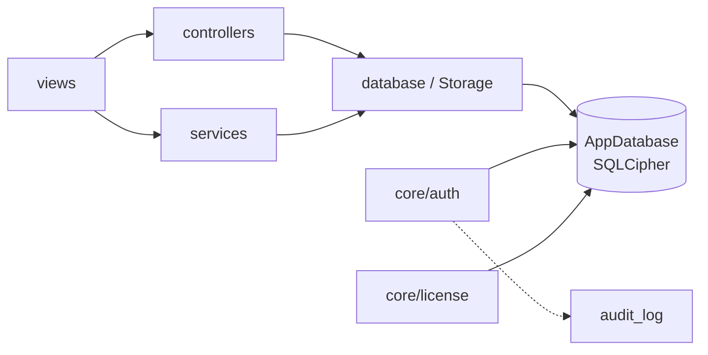

<div align="center">

# 💼 PureSip Payrolls

**An offline-first payroll & HR management system built with Flutter — encrypted, licensed offline, Arabic & English.**

[](https://github.com/ahmedtharwat19/payrolls/actions/workflows/ci.yml)


**English** · **[العربية](README.ar.md)**

[Overview](#-overview) • [What's New](#-whats-new) • [Features](#-features) • [Payroll Math](#-tax--insurance-calculation) • [Security](#-security--authentication) • [Licensing](#-offline-licensing) • [Getting Started](#-getting-started) • [Roadmap](#-roadmap)

</div>

> [!NOTE]
> **Windows** is the primary target platform, with additional **Android** support.
> The **web build is disabled by default**: its database is unencrypted and licensing is weaker.
> For experimentation only: `flutter run -d chrome --dart-define=ALLOW_WEB=true`

---

## 📌 Overview

PureSip Payrolls is built for small and medium-sized businesses that want to run payroll **completely independent of the internet**.

| Area | What you get |
|---|---|
| **Data** | Local database on the client machine, encrypted with SQLCipher on desktop |
| **Licensing** | Activation via a `.lic` file signed with Ed25519 and bound to the device fingerprint — no connection needed |
| **Calculations** | Editable tax and insurance brackets; supports both **Net** and **Gross** employees |
| **Output** | Arabic-ready PDF reports, Excel import/export |
| **Access control** | Users, roles and an audit log |

---

## 🆕 What's New

- **Portable database** — stored next to the executable instead of hidden system folders.
- **Dynamic database name** — the company name is read from `config.json` and names the DB file (e.g. `omicron.db`); the app **restarts automatically** when the name changes to keep the connection stable.
- **"Insured" flag** — marks whether an employee is subject to social insurance; if not, insurance is zeroed in every calculation.
- **Partial & bulk payments** — advances of 50%, 30% or a custom percentage, for one employee or a **whole department** at once.
- **Professional PDF reports** — full Arabic shaping, a dedicated bank sheet (IBAN & SWIFT), and bilingual company details in the header.

---

## ✨ Features

### 👥 Employees
- Complete personal, job and banking records.
- Bulk Excel import and export, plus a ready-made blank template.

### 💰 Payroll
- Monthly table for all employees: basic, overtime, allowances, deductions, tax, insurance, net (`payroll_page.dart`).
- **Double-click** any cell in an employee row to open a detail screen for quick edits (`employee_salary_detail_page.dart`).
- **"Generate"** button in the app bar creates a month's payroll records for all employees in one go.
- Horizontal scrollbar under the table, and PDF export.
- **Historical payroll** (`historical_payroll_page.dart`) and partial-payment adjustment (`payment_adjustment_page.dart`, `record_payment_dialog.dart`).

### 🕒 Attendance & Reports
- Attendance, overtime and lateness tracking (`attendance_controller.dart`).
- Monthly **cash vs. bank** disbursement reports (`reports_page.dart`).

### ⚙️ Settings
- Tax brackets, insurance rates, bank details, business rules (`rules_page.dart`) and company details (name and address for printing).

### 🔑 Permissions & Users
- Roles and permissions enforced across screens, a user-management screen and an audit-log viewer.

### 🧰 Data Tools
- Full backup export/restore, Excel import, and a fix for duplicated basic/allowances. The whole screen requires the `manageData` permission.

---

## 🧮 Tax & Insurance Calculation

Each employee has a `salaryType`. The logic lives in `payroll_calculation_service.dart`, with `tax_service.dart` and `insurance_service.dart`.

| Type | Meaning | Effect |
|---|---|---|
| **`gross`** | The entered salary is the taxable base | Tax and insurance are deducted from it, so the employee's net is lower than the agreed figure |
| **`net`** | The agreed salary is what the employee **receives** | The company bears the burden; the system raises the base automatically (**gross-up**) using binary search until net matches the agreed figure exactly |

The logic has a **single source of truth** (`PayrollCalculationService`) applied identically in three places — the payroll table, PDF export and monthly record generation — so numbers match everywhere.

**Calculation rules**

1. Insurable wage = basic + variable, after applying the minimum and maximum caps.
2. Annual taxable base = `(monthly income − employee insurance share) × 12 − personal exemption`, then brackets apply to the portion inside each bracket.
3. Deducting insurance from the taxable base is optional (tax settings).
4. All resulting amounts are rounded to the nearest piaster.

**Defaults** (editable from the rules page):

| Item | Value |
|---|---|
| Annual personal exemption | EGP 20,000 |
| Insurance — employee / employer | 11% / 18.75% |
| Min / max insurable wage | 2,000 / 12,600 |
| Annual brackets | 0–40k: 0% · 40–55k: 10% · 55–70k: 15% · 70–200k: 20% · 200–400k: 22.5% · 400k–1.2M: 25% · above 1.2M: 27.5% |

> [!WARNING]
> These are default values and change every year. **Review them with your accountant** before relying on them for real payouts.

---

## 🛡️ Security & Authentication

| Layer | Mechanism |
|---|---|
| **Passwords** | PBKDF2-HMAC-SHA256, 120K iterations, random per-user salt; legacy hashes are upgraded automatically on first successful login |
| **Password policy** | At least 8 characters, with letters and digits |
| **Account lockout** | After 5 failed attempts, with a doubling lock duration; every attempt is recorded in `audit_log` |
| **First account** | An `admin` account is created on first run with a **forced password change** (also after any admin reset) |
| **Admin protection** | The last active admin cannot be disabled or deleted, and users cannot disable themselves |
| **Database encryption** | SQLCipher on desktop; the key is kept in `flutter_secure_storage` (DPAPI / Keychain / Keystore) |
| **Sensitive operations** | Backup, restore and data wipe require `manageData` and are written to the audit log |

### Default roles

| Permission | admin | hr | accountant | viewer |
|---|:-:|:-:|:-:|:-:|
| View employees `viewEmployees` | ✅ | ✅ | ✅ | ✅ |
| Add / edit / delete employee | ✅ | — | — | — |
| View payroll `viewPayroll` | ✅ | ✅ | ✅ | ✅ |
| Run payroll `runPayroll` | ✅ | ✅ | ✅ | — |
| Edit salaries `editSalary` | ✅ | ✅ | — | — |
| Reports `viewReports` | ✅ | ✅ | ✅ | ✅ |
| Export reports `exportReports` | ✅ | ✅ | ✅ | — |
| Users, roles, settings, license, data | ✅ | — | — | — |

> [!NOTE]
> System roles are rewritten from code on every launch, so they cannot be modified in the database.

---

## 🔐 Offline Licensing

```mermaid
sequenceDiagram
    autonumber
    participant C as Customer
    participant A as App
    participant V as Issuer (license_admin_tool)
    C->>A: Opens the app; device fingerprint is shown
    C->>V: Sends the fingerprint
    V->>V: Builds payload → AES-256-GCM encrypt → Ed25519 sign
    V-->>C: .lic file
    C->>A: Imports the file
    A->>A: Verifies signature + device fingerprint + day counter
    A-->>C: Activated
```

- **Three layers:** binary packing → AES-256-GCM encryption → Ed25519 signature.
- **Activation** by importing a `.lic` file via `file_picker` (instead of pasting a long base64 code).
- **Local trial mode** for one month, bound to a single device; the "used" flag is stored in the database and in a sealed file outside it.
- **Issuing tool** `license_admin_tool` lives in a **separate repository**, keeping the private key away from the app code.

> [!IMPORTANT]
> Offline protection can never be absolute. The real protection is the **Ed25519 signature + device binding**; encryption and the HMAC seal are obfuscation that only deters casual tampering.
> After any key rotation, make sure the public key in `license_service.dart` is the latest.

---

## 🗄️ Database & Backups

- **Engine:** SQLite via `sqflite` + `sqflite_common_ffi` (desktop) + `sqflite_common_ffi_web` (browser), with SQLCipher via `hooks` in `pubspec.yaml`.
- **Location (portable):** next to the `.exe` on Windows.
- **Schema:** versioned with explicit upgrade paths (`onUpgrade`); current version is **12**.
- **Tables:** `users` · `roles` · `activated_devices` · `license` · `app_meta` · `employees` · `attendance` · `payroll_records` · `salary_payments` · `audit_log`.

> [!WARNING]
> **Back up the database file before the first launch after any update.**

### Backup tiers

| Tier | Location |
|---|---|
| 1 | `backups` folder inside the app data folder |
| 2 | `backups` folder next to the executable |
| 3 | Optional external folder chosen by the user (OneDrive-friendly) |

### JSON backup from the Data Tools screen

- **Includes:** employees, payroll, payments, attendance. **Intentionally excludes** the license, users and passwords, so a backup from a licensed machine can't be reused on another.
- **Restore** validates the entire file before changing anything (version, tables, columns) and runs inside **one transaction** (if any row fails, nothing changes). A full replace requires explicit confirmation.

> [!CAUTION]
> The JSON backup is **not encrypted** and contains sensitive data (national IDs, salaries, bank details). Store it safely and never send it over untrusted channels.

---

## 📂 Project Structure

```text
lib/
├─ controllers/        State (Provider): employees, attendance
├─ core/
│  ├─ audit/           Audit log (audit_log)
│  ├─ auth/            Users, roles, permissions, login & lockout
│  ├─ database/        Single source for the database (app_database.dart)
│  ├─ license/         License crypto, signing, activation + device fingerprint
│  ├─ security/        Password hashing (PBKDF2) and DB key
│  ├─ responsive/      Responsive breakpoints
│  ├─ theme/           Theme
│  └─ utils/           Logger and helpers
├─ database/           Per-entity data access layer (Storage)
├─ models/             Employee, payroll record, payment, attendance
├─ services/           Tax, insurance, payroll engine, Excel, PDF, backup
├─ views/
│  ├─ attendance/      Attendance screens
│  ├─ auth/            Login and password change
│  ├─ backup/          Backup and maintenance tools
│  ├─ employee/        Employee list, form and card
│  ├─ license/         License activation gate
│  ├─ payroll/         Payroll, details, history, payments
│  ├─ reports/         Cash / bank reports
│  ├─ settings/        General settings, rules, company details
│  ├─ tax_settings/    Tax settings
│  ├─ users/           User management and audit log
│  └─ shared/          Shared components (scaffold, permission gate, ...)
└─ main.dart
assets/
├─ lang/               ar.json · en.json (easy_localization)
├─ fonts/              Cairo · Tajawal · Roboto · NotoSans · Amiri
└─ images/
test/                  password_hasher_test · payroll_calculation_test
tools/                 create_keystore.sh
.github/workflows/     ci.yml
```



---

## 🛠️ Tech Stack

| Purpose | Library |
|---|---|
| State management | `provider` |
| Database | `sqflite`, `sqflite_common_ffi`, `sqflite_common_ffi_web`, `sqlite3` (SQLCipher) |
| Navigation | `go_router` |
| Localization | `easy_localization` (Arabic / English) |
| Crypto & signing | `cryptography` (Ed25519, AES-256-GCM), `crypto`, `pointycastle` |
| Secure storage | `flutter_secure_storage`, `shared_preferences` |
| Device fingerprint | `device_info_plus` |
| Files | `file_picker`, `path_provider`, `open_file`, `share_plus` |
| Excel | `excel` |
| PDF & Arabic | `pdf`, `printing`, `arabic_reshaper`, `bidi` |

---

## 🚀 Getting Started

**Requirements**

- Flutter (stable channel) **3.47 or newer** (Dart 3.13+).
- On Windows: Visual Studio with the **Desktop development with C++** workload.

```bash
git clone https://github.com/ahmedtharwat19/payrolls.git
cd payrolls
flutter pub get
flutter run -d windows        # or: -d <device_id>
```

**Build**

```bash
flutter build windows --release
flutter build appbundle --release   # requires android/key.properties (see Release & Signing)
```

### First launch
1. Activate a license via a `.lic` file (or start the local trial).
2. Sign in with the initial `admin` account; you will be **forced to change the password** immediately.

---

## 📥 Bulk Excel Import

The first row is the **header**; columns in order:

```text
name | department | jobTitle | nationalId | hireDate | contractType |
employeeType | insuranceCode | basicSalary | allowances | deductions |
salaryType | paymentMethod | bankName | bankAccount | bankSwift | bankIban
```

- The only required column is **`name`**.
- From **Data Tools** you can export a blank template, or fix legacy data where basic/allowances were duplicated by an earlier import.

---

## 🧪 Testing & CI

```bash
flutter analyze
flutter test
```

- Tests cover password hashing (PBKDF2 vectors), tax, insurance and net calculation.
- Both commands run automatically in **GitHub Actions** ([`ci.yml`](.github/workflows/ci.yml)) on every `push` and pull request.

---

## 📦 Release & Signing

**Android**

```bash
./tools/create_keystore.sh          # once: creates the keystore and writes android/key.properties
flutter build appbundle --release
```

> [!CAUTION]
> Keep an off-device backup of the `.jks` file and its passwords. If lost, you cannot update the app with the same signature. `key.properties` and the `.jks` are excluded from Git and must never be committed.

**Security notes for developers**

- **Never put a private key** in this repository. The Ed25519 signing key lives exclusively in the separate `license_admin_tool` repository.
- If any key leaks: rotate the whole pair, update the public key in `license_service.dart`, clean Git history (`git filter-repo`), and reissue `.lic` files for all customers.
- History cleanup, Android signing and tax-value review steps are in [`SECURITY_AND_RELEASE.md`](SECURITY_AND_RELEASE.md).

---

## 📚 Related Documents

| File | Contents |
|---|---|
| [`SECURITY_AND_RELEASE.md`](SECURITY_AND_RELEASE.md) | Security & release checklist: history, Android signing, accountant review, known limits |
| [`PAYROLL_FEATURES_README.md`](PAYROLL_FEATURES_README.md) | Historical integration guide from an earlier stage (some paths are outdated) |

---

## 🗺️ Roadmap

- [ ] Link previously generated payroll records (`PayrollRecord`) to later employee-data changes — currently, editing an employee after a month's record is generated does not update that historical record automatically.
- [ ] Expand tests to cover `AuthService` (lockout, last admin) and backups, plus widget tests for the login and users screens.

---

## 📞 Contact

- **Developer:** Ahmed Tharwat — [@ahmedtharwat19](https://github.com/ahmedtharwat19)

## ⚖️ License

All rights reserved © PureSip. The application is commercially licensed through device-bound `.lic` files.

---

<div align="center">

**Built with care for security and financial accuracy.**

</div>
